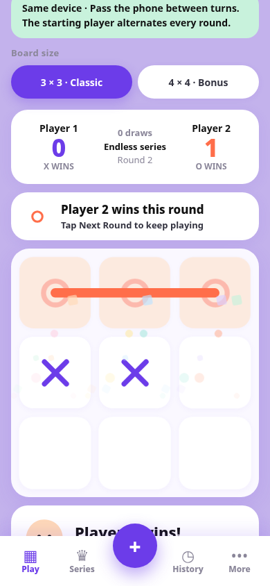

# Tic-Tac-Toe — The small game, taken seriously

Tic-Tac-Toe is a game prototype that takes the small game seriously, on 3x3 and 4x4 boards.

## What it does

- Play against the computer on Easy, Medium, or Hard. Hard uses full minimax and is honestly labelled unbeatable.
- Play against a friend on the same device.
- Series play: endless, or first to 3, 5, or 10, with a champion screen.
- Animated marks and winning line, undo, an optional move timer, and editable player names.
- Match history with filters, and stats that only count finished games.

## Status

Working prototype, built November 2026. A signed Android APK of this game also exists.

## Showcase only

This repository is a showcase. It contains no source code and no build files, and nothing here is open source. The screenshot(s) above are showcase images only. See NOTICE.md.

## Contact

Built by Yash Dashrath, Pune, India.

- Email: yashdashrath18@gmail.com
- LinkedIn: https://www.linkedin.com/in/yash-dashrath
- Yash MediaWorks: https://www.linkedin.com/company/yashmediaworks/
